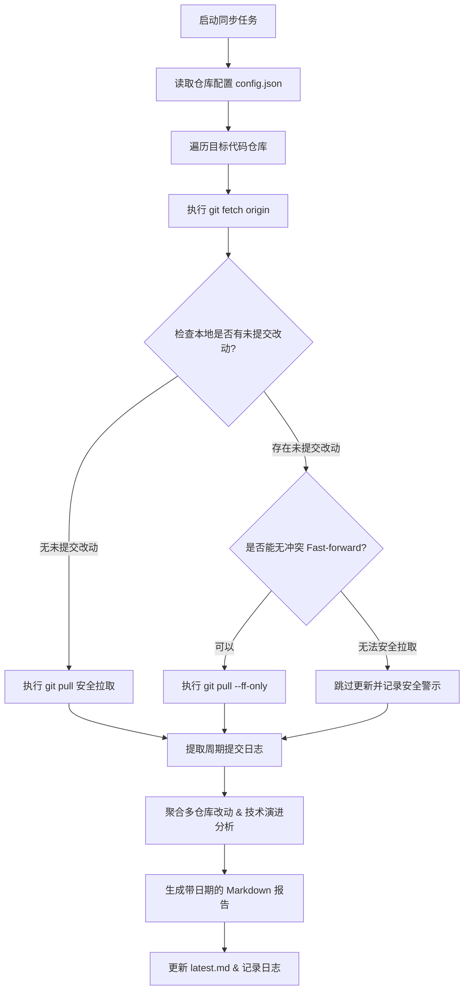

# my-repo-story (多仓库自动化同步与演进故事复盘)

当需要管理多个联动代码仓库、安全同步最新代码，并以技术叙事（Storytelling）的视角梳理过去一天（或指定周期）的架构演进与工程改动时，使用本技能。

---

## 核心能力与适用场景

1. **多仓库安全拉取与状态守护**：
   - 自动化批量执行 `fetch` 与 `pull`。
   - **本地冲突防护**：更新前严格检查本地工作区状态，若检测到未提交修改可能导致覆盖或冲突，**坚决跳过拉取**，保留本地工作现场，并在最终报告中以高亮 `[!WARNING]` 标明。
2. **周期性提交挖掘与特征聚类**：
   - 提取过去 24 小时（或自定义时间窗口）内各仓库的提交（包含 Hash、作者、相对时间、提交信息与 Diff 统计）。
   - 按 `feat`、`fix`、`refactor`、`perf`、`docs` 等工程维度进行提交分类。
3. **技术演进复盘（Storytelling 视角）**：
   - 借鉴 `/repo-story-time` 的考古叙事风格，不机械堆砌 Git log，而是提炼提交背后的技术动因、业务战役、关键架构改进与多组件联动影响。
4. **macOS 定时调度与合盖休眠支持**：
   - 提供开箱即用的 macOS `launchd` 配置模版，支持每天早晨 09:00:00 自动触发。
   - **深度休眠自动补跑**：若设定的时间点电脑合盖睡眠，系统在下次开盖唤醒的一瞬间自动补跑，确保每日分析不缺卡。

---

## 工作流程



---

## 目录结构推荐

在管理多个业务或技术组件时，推荐将调度配置与产物统一收敛：

```text
Scheduler/repo-story/
├── config.json                     # 仓库路径、主干分支与组件描述
├── prompt.md                       # 故事分析提示词与分析标准
├── sync_and_story.py               # 执行脚本 (核心引擎)
├── run.sh                          # launchd 调度入口 (已设置 PATH 与日志重定向)
├── com.example.repo-story.plist    # macOS launchd 定时服务配置
├── reports/                        # 历史报告归档 (YYYY-MM-DD.md 与 latest.md)
└── logs/                           # 任务运行与错误日志
```

---

## 配置文件规范 (`config.json`)

配置采用通用、脱敏的 JSON 结构，支持任意语言和技术栈的 Git 仓库：

```json
{
  "scheduler_name": "Multi-Repo Daily Story",
  "schedule": "Every day at 09:00:00 CST",
  "paths": {
    "reports_dir": "./reports",
    "logs_dir": "./logs"
  },
  "repositories": [
    {
      "key": "gateway-service",
      "name": "API Gateway & Routing Service",
      "path": "/path/to/gateway",
      "default_branch": "main",
      "sub_components": ["proxy", "auth", "ratelimit"]
    },
    {
      "key": "agent-runtime",
      "name": "Core Agent Execution Runtime",
      "path": "/path/to/runtime",
      "default_branch": "develop",
      "sub_components": ["engine", "sandbox", "memory"]
    }
  ]
}
```

---

## 脚本工具与使用

技能自带脱敏脚本位于 `scripts/sync_and_story.py`：

```bash
# 使用指定配置文件运行
python3 scripts/sync_and_story.py --config ./config.json

# 指定时间范围（如查看过去 48 小时）
python3 scripts/sync_and_story.py --config ./config.json --since "48 hours ago"

# 仅检查状态不执行实际拉取 (Dry Run)
python3 scripts/sync_and_story.py --config ./config.json --dry-run
```

---

## 定时任务与合盖休眠配置

若需在 macOS 上配置每天 09:00 自动执行：
1. 将 `examples/launchd.plist` 中的路径修改为本地真实路径；
2. 复制到用户 LaunchAgents 目录：
   ```bash
   cp examples/launchd.plist ~/Library/LaunchAgents/com.user.repo-story.plist
   ```
3. 注册并加载：
   ```bash
   launchctl load -w ~/Library/LaunchAgents/com.user.repo-story.plist
   ```
4. **合盖休眠说明**：macOS 原生 `launchd` 的 `StartCalendarInterval` 机制会在休眠期间挂起任务，并在电脑唤醒后的第一时间自动触发补跑。
